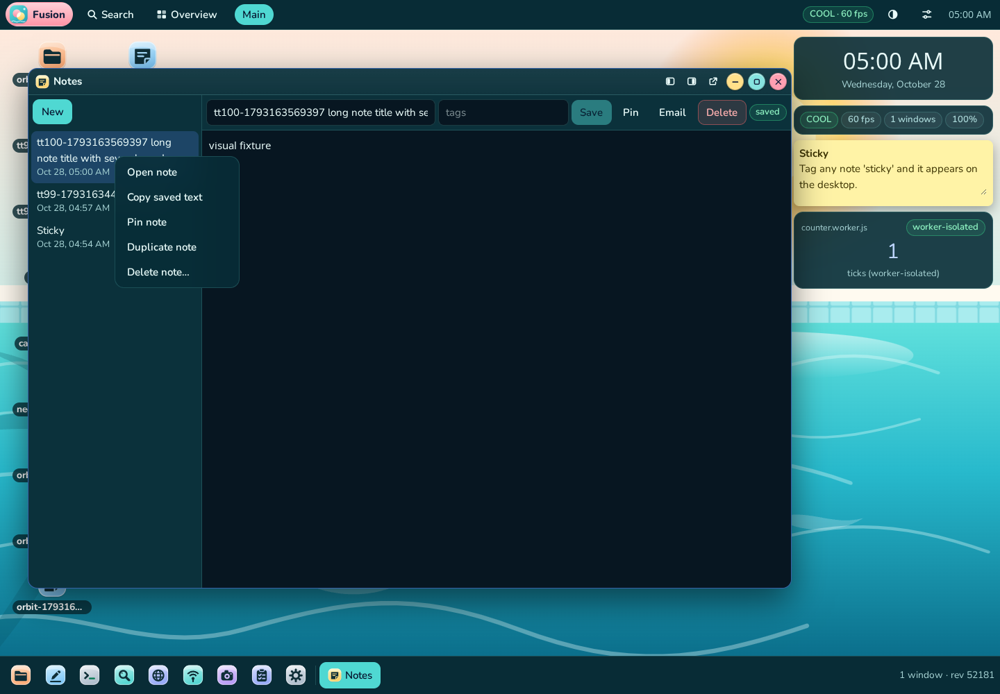
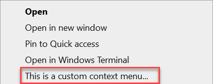
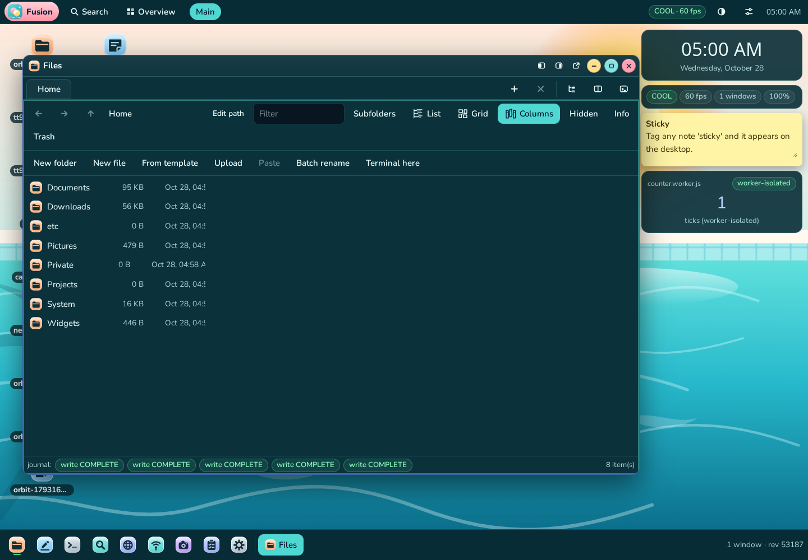
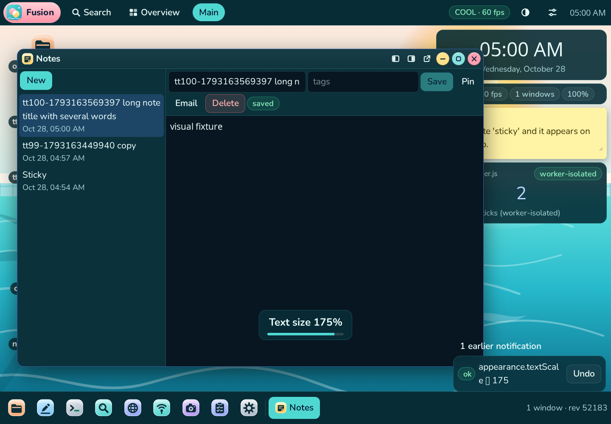
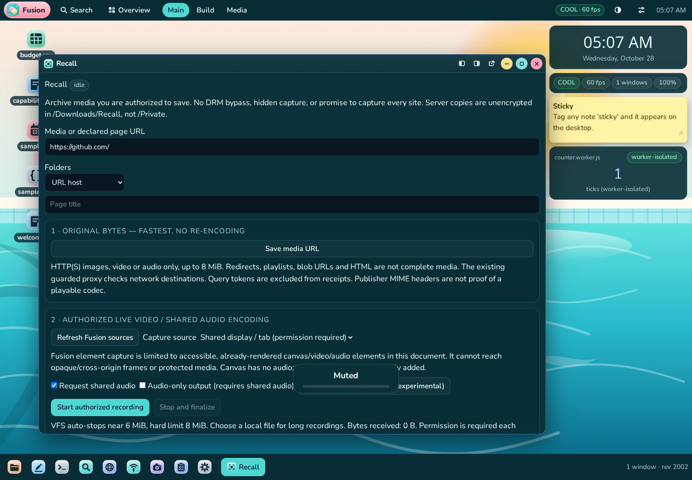

# TT100 — Recall and bounded desktop refinements

## A. Verdict and evidence standard

**Final clean production gate: 217/217 assertions across 17 suites; Recall: 27/27.** The result is recorded in `docs/evidence/tt100-production-final.log`; individual machine-readable assertions are in `docs/test-results/*.json`.

**The universal media-capture request, all-app Class A goal, and ten additional complete Class A specification rows are NOT established. No canonical grade is promoted.** Recall provides three implemented mechanisms: original HTTP response-byte archiving, live MediaStream encoding, and PNG frame rasterization. DOM discovery orchestrates the first mechanism; it is not a fourth capture mechanism. Native display sharing and native local-file streaming are not certified by the headless evidence.

Evidence threshold:
- **H+**: an executable bounded witness passes, with an external observation where available: HTTP publisher bytes, PostgreSQL-backed filesystem API, Node SHA-256, native browser image/video/audio decoding, actual DOM/native drag events, or axe-core. This is not a universal correctness proof.
- **H−**: a scoped proposed solution is refuted by a concrete counterexample, or a standards-imposed access boundary excludes it. Normative restrictions are distinguished from physical browser experiments.
- **H∂**: implemented but not verified at the necessary boundary, or only a proper subset is demonstrated. Compilation, a capability flag, and a successful button click alone do not meet H+ for capture.

No independent agent, human reviewer, formal prover, physical screen-sharing picker, physical microphone, or other browser was used. One coding agent used the actual repository, Node, TypeScript, ESLint, Next production compilation, PostgreSQL, Playwright/real Chromium, native media encoders/decoders, axe-core, and Python's standard-library ZIP reader. The new Recall suite does not intercept network requests, replace browser media APIs, inject fake permission responses, or use fake-camera flags. Its reproducible audio source is a generated PCM sine-wave WAV, played by the real Media module and captured/encoded by the real browser; it is not a physical system-audio or music-fidelity test.

## B. Formal scope, admissible objects and quantifiers

Let U be absolute HTTP(S) URLs, at most 8,192 characters, with no embedded username/password. Let R be responses admitted by the existing SSRF-guarded raw proxy and bounded browser-save reader. Accepted media MIME labels are image/*, video/* or audio/*, excluding playlist labels. HTML labels, 206 partial responses, redirects and over-limit bodies are rejected. MIME is the publisher's claim, not proof of codec validity.

For a successful original-response witness, the committed media bytes must equal the complete received response bytes, the receipt's SHA-256 must match those bytes, and a repeated save must not overwrite the earlier asset. This contract does not assert that every URL succeeds or that every publisher-supplied payload is playable.

For live encoding, admissible sources are (a) a user-selected display/tab stream granted by the browser, or (b) an accessible, connected Fusion canvas/video/audio element in the current document. Recall excludes its own preview and explicitly rejects protected media elements. A canvas has no audio. Already-rendered Fusion media must actually expose capture tracks; paused, cross-origin, protected, opaque-frame, MSE/blob and unsupported sources are not promised.

For PNG rasterization, success means a decoded video frame is rasterized to a decodable PNG under the frame/byte budgets. This is a new image, not original bytes, a capture of arbitrary nested DOM, or a DRM workaround. The test compares an actual source-canvas pixel with the decoded output, not dimensions alone.

Folder policies are URL host, page title or custom name, sanitized beneath `/Downloads/Recall`. Capture source/page URLs are user-declared labels, not an attestation of the surface selected in a native picker. Receipts distinguish `requested-url` from `user-declared-label`; query strings and fragments are removed. URL paths, hostnames, folder labels and titles may still be sensitive.

Universal quantification over all sites, formats, browsers, permissions, live streams, durations, encoders and storage failures is outside the proven domain. The tests supply finite witnesses, not that universal quantifier.

### Resource and persistence boundaries

| Resource | Contract |
|---|---|
| VFS media | Nonempty, at most 8 MiB; no intentional truncation |
| VFS recorder | Requests stop at approximately 6 MiB; rejects output over 8 MiB, including overshooting final chunks |
| Native streaming | Experimental WebM destination; at most 16 MiB queued writes; actual writer/backpressure failures unverified |
| Frames | At most 16,777,216 pixels at acquisition; owned canvas relay sampled at 30 fps |
| Preview | Decodable-preview wait bounded by 8 seconds; native permission chooser itself remains user-controlled |
| Original downloads | 16 pending, one active; 30-second fetch deadline; terminal history trimmed on admission (up to 33 terminal entries between admissions), UI shows last 24 |
| Discovery | Opt-in; same original origin; 200 admitted URL budget per armed document, at most 2,000 inspected nodes per scan; 300 ms debounce and 3-second retry heartbeat |
| Durability | Conditional create for media and receipt separately, NOT a two-file atomic transaction |
| Privacy | Server copies unencrypted in `/Downloads/Recall`, not `/Private`; amnesic server writes refused; user-authorized local export is separate |
| Cancellation | Pending/fetching jobs cancel; a started database commit cannot be rolled back by the Cancel button |

A receipt hashes bytes; it is neither a signed publisher certificate nor an immutable/tamper-proof record. Receipt creation failure explicitly reports the partial media path. Unknown network/commit outcomes require inspection in Files, not blind retry.

## C. Research and browser-security lower bounds

The best supported browser-native combination for this scope is bounded HTTP-byte archiving plus user-authorized MediaStream encoding and raster snapshots, with feature detection and explicit refusals. A desktop extension, privileged native helper, external downloader or custom DRM extractor was not introduced.

- Display capture needs a secure context and transient user activation; its chooser cannot silently be bypassed and permission is requested for each session. Audio depends on the chosen surface, browser and OS. These are documented API boundaries, not physically verified sharing behavior here. [1](https://developer.mozilla.org/en-US/docs/Web/API/MediaDevices/getDisplayMedia)
- Shared-audio support must be checked per browser/source; requesting audio does not manufacture an audio track. [2](https://developer.mozilla.org/en-US/docs/Web/API/Screen_Capture_API/Using_Screen_Capture)
- Sensitive capture and native file-picker APIs require user activation. [3](https://developer.mozilla.org/en-US/docs/Web/Security/User_activation)
- MediaRecorder encodes an existing MediaStream with a supported container/codec; it is not an original-file extractor. [9](https://developer.mozilla.org/en-US/docs/Web/API/MediaRecorder/MediaRecorder)
- Native save-file picking is not Baseline across major browsers and requires a secure context. [6](https://developer.mozilla.org/en-US/docs/Web/API/Window/showSaveFilePicker)
- Permissions Policy can forbid display capture even where the API exists. [15](https://developer.mozilla.org/en-US/docs/Web/HTTP/Reference/Headers/Permissions-Policy)

These MDN sources were actually searched in this session. Earlier research also consulted Screen Capture specification search results at https://www.w3.org/TR/screen-capture/ and https://w3c.github.io/mediacapture-screen-share/ concerning explicit surface selection and consent. No third-party implementation was copied. No claim is made that this is an exhaustive survey of all commercial recording products.

## D. Mechanism-distinct candidates, artifacts, gaps and falsifiers

| Approach | Artifact / proven portion | Gap or required hypothesis | Candidate-specific falsifier / status |
|---|---|---|---|
| 1. HTTP original-byte acquisition | `recall.ts`, guarded raw proxy, byte/SHA equality against real HTTP publisher | Accessible complete bounded response; headers can lie; authenticated/live/redirected assets may fail | 206, redirect, playlist, HTML and 9 MiB real responses refused; valid PNG exact equality H+ |
| 2. DOM URL discovery | `wp-shim.js`, `ProxyFrame.tsx`; actual image insertion and mutations archive once while armed | Only exposed HTTP(S) elements in this document, same original origin; untrusted page can propose same-origin URLs | Unarmed/disarmed page, forged top-level message, actual cross-origin img, 22-image queue-pressure batch H+ within scope |
| 3. Accessible-element stream acquisition | Recall canvas relay and media-element `captureStream` | No opaque-frame/DRM access; current document only; source must remain eligible | Close the actual source application, then capture; explicit failure without wedged busy state H+ |
| 4. User-consented display acquisition | Audited `displayMedia` call from click handler | Native picker, HTTPS, policy, chosen surface and optional audio | Physical grant/deny/revoke and shared system audio remain H∂; standards exclude silent capture H− |
| 5. MediaStream encoding | Actual MediaRecorder WebM and real WAV→element→encoded audio | Encoders vary; timing/seek/fidelity/long sessions not exhaustively measured | Decodable video metadata; decoded audio RMS > .01; canvas audio-only refusal and retry H+ for these witnesses |
| 6. Frame rasterization | Native canvas PNG encoding and `createImageBitmap` decode | Raster rather than original quality/metadata; origin-clean surface, bounded pixels | Compare real source pixel and decoded pixel, dimensions/nonempty PNG H+; taint/oversize branches not exhaustively exercised |
| 7. Native disk sink | Ordered writes, queued-byte cap, close/abort and nonempty checks | Native picker and real storage semantics; no checksum receipt for this sink | Unavailable picker gives explicit fallback error by code; successful native write, slow disk and crash remain H∂ |
| 8. VFS conditional-create sink and receipt | Existing FS APIs; fresh UUID paths, SHA receipt, explicit partial-commit error | Two operations, not one atomic media+receipt transaction; server availability | Repeat save preserves prior files H+; receipt write failure/unknown commit outcome remain H∂ |

Only mechanisms 1, 5 and 6 count as the three media transformation/acquisition methods advertised by the app. Source acquisition, discovery and sinks are listed separately to expose different assumptions rather than inflate that count.

## E. False solutions rejected (21 shapes)

1. Rename every downloaded response `.mp4` and call it video.
2. Save page HTML and call it the page's original image/music/movie.
3. Save an HLS/DASH playlist or one segment and call it the complete recording.
4. Treat a 206 partial response as a full archive.
5. Trust MIME labels as a codec/playback certificate.
6. Call `getDisplayMedia` in a timer and pretend silent capture is authorized.
7. Treat `audio: true` as proof a shared audio track was granted.
8. Substitute microphone audio for absent tab/system audio without telling the user.
9. Claim a server proxy removes DRM, EME, opaque-origin or browser picker restrictions.
10. Treat an opaque/MSE/blob URL as an ordinary original HTTP file.
11. Treat DOM discovery as a new recording codec or a fourth capture method.
12. Mark every postMessage as trusted without checking its source window and URL origin.
13. Start discovery automatically before opt-in, or keep its queued jobs after disarm/close.
14. Mark a full-queue URL seen and permanently lose it; the heartbeat retry and 22-image batch attack address this.
15. Claim MediaRecorder chunks are separately playable complete files.
16. Buffer unlimited recordings or silently truncate at an arbitrary byte cap.
17. Show “saved” immediately after clicking Stop instead of awaiting encoding and storage.
18. Call a hash receipt transactional, immutable, encrypted, or proof of publisher identity.
19. Pass a screenshot/metadata-only decoder check and infer correct image pixels, audio content or long-video fidelity. PNG pixels and decoded audio energy are now checked; video seek/fidelity is still not certified.
20. Treat server acknowledgement as stable UI geometry. Native tracing showed the next drag actually began on `a6`, not the requested `drag2`, while the previous refresh removed a row. The test now waits for actual UI acknowledgement and asserts the native event's target.
21. Claim three tiny UI refinements prove all applications Class A, or claim a stock gallery icon is a screenshot of native OS behavior. Neither is valid evidence.

## F. Repairs, adversarial progression and preserved failures

- Initial Recall development run: 18/22, preserved in `tt100-initial-18of22.json`. Static/occluded canvases needed an owned relay; React StrictMode's effect replay exposed a mounted flag never reset to true. The mount setup was repaired, timers/tracks cleaned up, and real PNG/WebM tests rerun. No fake capture API was installed.
- A later auto-discovery run used stale fixed folder counts against accumulated data. The fixture now uses a unique custom folder each run; the real file-count assertions were retained.
- The expanded suite verifies actual non-silent audio, recovery after a no-audio refusal, closing a selected source app, a batch exceeding pending queue capacity, cross-origin rejection and amnesic refusal. It contains 27 bounded cases, not 27 complete specification rows.
- First broad production gate had 11/13 Files assertions: a missing real Python ZIP reader and a native drag failure. A real Python venv was created. A subsequent 13/13 did not settle the intermittent native-input issue; the failure recurred and was retained.
- Read-only native event tracing (`tt100-native-drag-failure-trace.json`) established the erroneous actual dragstart target and shifted folder geometry. The test now waits for the first moved row to leave the DOM before the next native drag, and explicitly asserts the second native drag starts on `drag2`. It did not replace native drags or relax server hash/path assertions. Six further unselected native drags form an added stress witness. The inherited Ctrl-drop branch still dispatches a synthetic DragEvent; it is NOT evidence of physical Ctrl-drag behavior.
- Visual inspection found low-contrast selected Files view buttons during background-only transitions. A targeted attack on the old production build failed: actual `rgba(79,216,210,0.1)` versus required opaque `rgb(79,216,210)`, in `tt100-view-contrast-prepatch.log`. The three view buttons now swap foreground/background without transition, and the new immediate computed-style assertion must pass after every selection.
- The initial gate, the pre-visual-repair passing gate, and the later native-input diagnostic failure are retained separately. Only the final clean database run is the final gate; no intermediate green label substitutes for it.

## G. UI work and visual comparison

**Ordering deviation:** UI edits were made before Recall's verification was complete. This did not comply with the requested “recording task first, UI only afterward” sequence. Moreover, physical capture/local-streaming gaps remain, so universal Recall completion is not claimed retroactively.

### Context menus

Orbit is content-sized and bounded (160–320 px); Files and Desktop object menus also have viewport-bounded compact widths. This preserves their existing command models rather than replacing object-specific actions with a single generic menu.

The actual Fusion screenshot was visually inspected. The menu contains short vertically stacked commands and consumes a small region rather than the page width. The following Microsoft documentation image is an unmodified **Windows File Explorer context-menu excerpt**, not an interactive Windows test, whole-desktop benchmark, or DPI-matched measurement. Both references illustrate compact vertical command lists. Fusion's bounded width is independently measured by the real browser test. No pixel-parity, all-menu-state parity, macOS comparison or equal-font-size width ratio is claimed.





Reference: Microsoft, `MicrosoftDocs/windows-dev-docs`, `hub/apps/desktop/modernize/images/file-explorer/folder-context-menu.png`; pinned revision in `tt100-windows-reference-commit.txt`, original at https://github.com/MicrosoftDocs/windows-dev-docs/blob/docs/hub/apps/desktop/modernize/images/file-explorer/folder-context-menu.png. Attribution 4.0 license in `tt100-windows-reference-LICENSE.txt`. Used only as documentation evidence, never as runtime artwork or copied source.

### List / Grid / Columns

`FileViewGlyph.tsx` contains independently authored SVG coordinates: stepped leaves on a list spine, a four-tile pinwheel, and staggered connected depth lanes. Labels remain alongside the icons; SVGs are decorative to assistive technology and buttons expose `aria-pressed`. The shared FilesPane supplies both single and dual panes/tabs. A source search found no second Files list/grid/columns control needing a divergent icon implementation. Global visual novelty cannot be proven; no icon was traced, imported or renamed from another library.



### Notifications and Undo

Action notifications now use a bounded bottom-right translucent deck. The latest card is frontmost, older notifications have a decorative depth stack, and a button expands history so earlier Undo remains reachable. The real test changes a persisted setting twice and uses the older Undo to restore its original server value. The root is width-bounded to 360 px, corner-anchored, with a bounded scrolling list rather than monopolizing the right side. Forced-colors fallback is present.

The screenshot shows the compact corner deck and earlier-notification control, not just an empty container. Visual limitation: with a taller wrapped front message, the fixed-height decorative rear cards can be largely obscured. The existence of those cards in the DOM does not prove an obvious depth effect for every message; that part is not fully visually accepted. The separate center-bottom text-size OSD is existing transient system feedback, not the action-notification deck. Quick panel is closed in the stack screenshot to avoid confusing its separate panel with notifications.



## H. Verification matrix

Final clean production run: **217 passed, 0 failed**, against newly created `tt100_final3`, after the view-transition repair and native-drag fixture correction. No application source changed after this gate.

| Suite | Passed / total (see individual JSON) |
|---|---:|
| unit | 23/23 |
| integration | 25/25 |
| browser-session | 5/5 |
| tt55-files-unit | 7/7 |
| e2e-tt55-files | 14/14 |
| e2e-tt55-shell | 3/3 |
| e2e-tt96-desktop-menu | 5/5 |
| tt97-palette-commands | 4/4 |
| e2e-tt97-palette-actions | 11/11 |
| e2e-tt97-files-empty-a11y | 3/3 |
| e2e-tt98-orbit | 22/22 |
| e2e-tt99-interactions | 29/29 |
| privacy-layer | 13/13 |
| e2e-browser | 6/6 |
| tt69-lifecycle | 11/11 |
| e2e-tt100-recall | 27/27 |
| e2e-a11y (full, no AXE_ONLY/AXE_SKIP_REST) | 9/9 |

The accessibility suite opens all 47 registered modules and exercises its existing shell, reflow, forced-color and light-style contrast cases. Axe's nine top-level results do not certify every interaction, hover state or capture prompt. The contrast bug found visually despite an earlier green axe run illustrates this boundary.

Application TypeScript and production compilation pass. Focused ESLint passes for the new Recall/core/queue, glyph, toast, Orbit, ProxyFrame, FilesPane and new test/HTTP fixture files. **Full repository lint is not green: 173 errors and 16 warnings**, actually rerun and retained in `tt100-full-lint.log`; this matches the previous reported total, not a claim every touched historical file is lint-clean.

The broad legacy `e2e` suite with fake-device flags is deliberately not part of this final media evidence. The historical TT99 237/237 result is not re-labelled TT100. Unit suites include controlled timing/dependency models (for example TT69's fake clock); these are explicitly pure/model regression tests, not physical capture evidence.

More than ten bounded behaviors are exercised: exact original bytes, SHA receipt, repeat-save safety, partial rejection, size rejection, redirect rejection, playlist refusal, fetch cancellation, PNG raster pixels, real WebM encoding, close/cancel guard, real encoded non-silent audio, missing-audio refusal/retry, stale-source refusal, opt-in/disarm, dedup/mutations, queue pressure, cross-origin/forged-window rejection, amnesic refusal, compact menu, three view controls and persisted Undo. This list does NOT establish ten additional whole Class A core features.

## I. Exact remaining gaps and strongest artifact

| Claim | Current boundary |
|---|---|
| Original byte archive, local publisher | H+ exact byte/SHA witnesses under explicit test-only loopback exception |
| PNG and static Fusion canvas WebM | H+ real encoders/decoders; PNG source-pixel match; video width/EBML/nonempty check, not end-seek/duration/motion fidelity |
| Audio recording | H+ real element capture of a known PCM signal with non-silent decoded output; NOT system audio, protected music or perceptual fidelity |
| Native display/tab picker and sharing lifecycle | H∂; no physical grant, rejection, revocation, system-audio or browser-chrome test |
| Native local streaming | H∂; implementation labelled experimental; successful picker/write, permission loss, slow disk, abort/crash and long files unverified |
| Browser/site compatibility | H∂; headless Chromium only, no Firefox/Safari/mobile real-device matrix or all-site survey |
| Comprehensive hostile same-origin page | H∂; source-window/origin/budgets checked, but an armed untrusted page can still propose arbitrary same-origin URLs |
| Codec authenticity and protected media | H∂; bytes and declared MIME are retained, not universal playback/DRM proof; standards rule out unauthorized universal capture |
| VFS media+receipt atomicity | H∂; explicitly separate commits, partial-path message; fault injection/uncertain completion not covered |
| Every app Class A / ten complete additional rows | Not established; no grade changes |
| Toast depth for all content | H∂; compact geometry and real Undo pass, but wrapped front cards can obscure decorative back-card edges |
| All OS context-menu semantics | Not established; bounded shared-menu regressions and visual excerpt comparison only |

The strongest artifact is the original implementation plus reproducible bounded production evidence and explicit negative boundaries. It is not a universal capture theorem or an all-app certification. Physical secure-context picker tests, real disk fault/backpressure tests, seek/duration/sound fidelity oracles, broader adversarial-origin review, additional engines and a canonical feature-by-feature audit are the next requirements before stronger claims.

## J. Reproduction, preview and delivery

No runtime dependency, database schema, permissive-stack license or external service was added for Recall. Existing framework, guarded proxy, VFS, privacy and media APIs are reused. Test-only Chromium/PostgreSQL/Python tooling stays outside the repository; recordings and databases are not committed. The external Microsoft reference is documentation-only, attributed separately.

1. `npm ci`; supply a real PostgreSQL database through `DATABASE_URL`.
2. Apply schema explicitly: `npx drizzle-kit push --dialect=postgresql --schema=./src/db/schema.ts --url="$DATABASE_URL"`. The repository's checked-in Drizzle config contains a different default URL, so do not assume it matches the server.
3. `npm run typecheck`; `NEXT_TELEMETRY_DISABLED=1 npm run build`.
4. For the exclusive test only: start `node scripts/tt100-fixture.mjs` (HTTP port 4001), and start production with `FUSION_WP_TEST_LOOPBACK_PORTS=4001 DATABASE_URL=<fresh-disposable-db> npm run start -- --hostname 0.0.0.0 --port 3000`.
5. Run the command below against that matching database. A real Python stdlib interpreter is expected at `/home/user/tools/venv/bin/python` by the inherited Files ZIP oracle; `python3 -m venv /home/user/tools/venv` supplies it in this environment.

```sh
TT89_DISPOSABLE_DATABASE=1 \
DATABASE_URL=postgresql://postgres@127.0.0.1/tt100_final3 \
BASE=http://127.0.0.1:3000 \
SUITES='unit integration browser-session tt55-files-unit e2e-tt55-files e2e-tt55-shell e2e-tt96-desktop-menu tt97-palette-commands e2e-tt97-palette-actions e2e-tt97-files-empty-a11y e2e-tt98-orbit e2e-tt99-interactions privacy-layer e2e-browser tt69-lifecycle e2e-tt100-recall e2e-a11y' \
bash scripts/run-all.sh
```

For a normal preview, stop the test publisher/server, use the separately initialized `tt100_preview` database, and **omit** `FUSION_WP_TEST_LOOPBACK_PORTS`. Native capture needs the user's supported secure browser and active consent. The local native file sink remains experimental. Browser-proxy discovery is opt-in per document; enable Auto Recall only for media you are authorized to archive. To try Fusion element capture, open Image Editor or play a local file in Media, open Recall, refresh sources, select the element and choose capture/record. Saved VFS files can be revealed in Files. Permission/API failures are errors, not simulated recordings.

The final production preview runs on port 3000 with the separate `tt100_preview` database; the test publisher is stopped and the test-only loopback exception is omitted. `smoke-tt100-preview.mts` passed five real API/DB/browser checks, including rejection of port 4001 and standard-port loopback, no test recordings/fixtures, three actual method sections and no page errors (`tt100-preview-smoke.json`). The first smoke expected the private-address error before the standard-port guard; its preserved failure led to separate assertions for both guards, not an implementation bypass. A field-guide note explains use and limits. The final preview screenshot was actually inspected.



GitHub PR and merge status are reported separately from the reproducible test evidence. No branch switch or assumed merge is part of this report.
