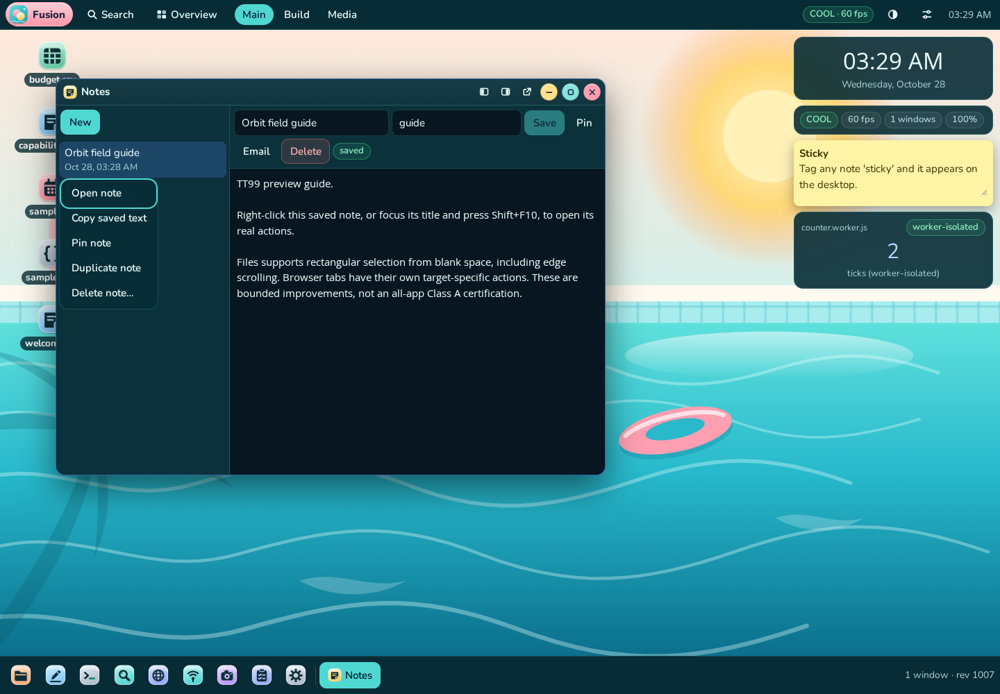

# TT99 — Object actions, scrolling selection and honest verification

## Delivery verdict

**Final production gate: 237/237 assertions across 16 suites; TT99 interactions: 29/29.** Production compilation and TypeScript pass. A separate production preview is running on port 3000, backed by `tt99_preview`, not the test database. Its real-browser smoke passes five checks. The screenshot below is an actual browser capture, not a generated UI.

**The all-app Class A goal and ten additional complete Class A specification rows are NOT established. No canonical grade was promoted.** This turn delivers more than ten bounded functional improvements; it does not substitute that count for ten entire core features. The [46-app inventory](TT99-CONTEXT-INVENTORY.md) explicitly distinguishes object-specific actions, generic window controls and unverified semantic surfaces.

TT98 was already merged as PR #4. TT99 also resolves two carry-over verification uncertainties: the loaded Editor now displays its real Keep/Save/status controls, and the general suite's actual two-context WebRTC exchange passes after fixing its ambiguous dialog locator and cleanup. Neither result proves physical camera/microphone or Internet-wide peer connectivity.



## A. Runtime honesty and admissible scope

Actually used: local git and GitHub CLI; Node 22.22.3/npm; TypeScript 5.9.3; ESLint; Next 16.2.6 production compilation with React 19.2.6; disposable PostgreSQL 18.4 from an external test-tools installation; real Chromium 143 through Playwright 1.64.1; axe-core; Python standard-library ZIP inspection in the existing Files suite; web-search excerpts; file inspection and screenshots. Some independent tool calls ran concurrently; test suites sharing a desktop/database ran sequentially.

There were **no independent agents, external human auditors, theorem provers, physical-device trials, screen-reader users, Firefox/Safari runs, or native-OS integration tests**. Axe is an external checking library executed here, not an independent audit. The inherited general browser suite uses Chromium's explicit fake camera/microphone flags to feed real media processing; that is **synthetic sensor input**, not evidence of physical hardware. WebRTC signalling and data-channel exchange use real PostgreSQL and real browser contexts on this machine. The TT99 interaction suite fabricates neither application implementations nor API responses. Its negative control exercises the test poller's rejection behavior, not a fake service.

Admissible application objects: saved notes; shown/held alerts; Find file hits; horizontal/vertical Browser tabs; Files rows/grid items/current pane and ancestor navigation entries; classic-desktop VFS icons; app/window backgrounds. Selection operates on rendered DOM items, including offscreen items that remain mounted. The new tests create real files, notes and alerts in disposable databases.

Access: existing same-origin APIs, existing privacy routing and existing shell/window reducers. No new server route, runtime dependency, native permission bypass, external clipboard read, or native-app interception was added. Text labels are React-rendered values, not evaluated code. Native inputs, textareas, selects, contenteditable regions, links, media and canvas are excluded from the generic context fallback where applicable. A child handler's prevention of default takes precedence.

## B. Formal contract, resources and outcome space

For a supported non-touch blank-space primary-pointer gesture, let B be the gesture-start selection and let A be the starting point in its chosen scroll surface's **content coordinates**. For each delivered move/scroll update, form the axis-aligned content rectangle between A and the current pointer translated by the current scroll offset. Clip it to content bounds. Let I be the rendered items on that scroll surface whose rectangles have **positive-area** intersection with that rectangle. Selection is I, or B ∪ I when Ctrl/Command/Shift was held at pointer-down. Modifiers are sampled once, not reinterpreted halfway through the drag.

Normal release commits the selection and suppresses the release click after a moved rectangle. Escape, pointer cancellation, capture loss, blur, resize or page hiding rolls back to B. Unmount cancels the frame resource. Touch is deliberately not a marquee input. The movement threshold is 4 CSS px; boundary contact alone is not an intersection. Pen is admitted by code but not certified by physical pen testing.

Auto-scroll uses a 28 CSS-px edge zone, a velocity coefficient of 0.7 px/ms, and elapsed time clamped to 0–32 ms to avoid a huge catch-up jump. The final implementation carries fractional pixels across frames and keeps scheduling while scrolling in that direction is possible. A frame that rounds to zero is not a stopping condition. At an actual bound, outside the zone, or after termination, it stops. This replaces the earlier incomplete 8-ms minimum workaround. Event/frame delivery remains a browser assumption; there is no wall-clock or high-refresh-rate performance guarantee.

Resources: O(n) rectangle reads and selection work per update for n rendered items, O(n) selection storage, two fractional accumulators and at most one scheduled animation frame per active hook. The new scroll fixtures contain 55 actual files. No arbitrary-size benchmark, maximum-memory theorem, virtualization contract or optimality result is claimed. The Browser retains the existing 100-tab limit; duplicate-URL actions are guarded against exceeding it.

A context action must bind to its invoked object, invoke a real existing reducer/API, report errors through the existing error surface, and not claim completion merely because a menu closed. Draft-dependent Notes actions are disabled rather than discarding unsaved text. Find obtains current kind/MIME before opening and refuses absent/trashed nodes. Browser batch actions bind to the clicked tab and preserve pinned tabs according to the existing reducer. “Duplicate URL in new tab” deliberately does not claim to duplicate native browser navigation history.

Acceptance categories:

- **H+ — bounded implementation witness:** production build plus recorded real UI and/or API oracle for the explicitly listed case. This is finite test evidence, not universal quantification over all devices, timings and objects.
- **H− — scoped negative witness:** old production code fails the new inner-edge attack; the async poller rejects a false negative control; stale Find results cannot create a document through the tested action. Missing native permissions/APIs remain missing. These are not impossibility theorems about every possible OS-like PWA.
- **H∂ — boundary/partial:** native editing, cross-origin documents, touch, 3D, clipboard permissions, missing providers, platform isolation and untested semantic objects. A generic window menu is not certification of a Contacts/Sheet/Timeline/etc. object menu.

The requested universal claim would quantify over all registered apps × all semantic object types × all relevant states/input modes/platforms. This work does not discharge those quantifiers.

## C. Research and permissible implementation

Research used documentation/search excerpts, not copied application implementations. Relevant platform conventions consulted:

- Apple selection guidance: [1](https://support.apple.com/guide/mac-help/select-items-mchlp1378/mac); keyboard/copy conventions: [4](https://support.apple.com/en-us/102650). These informed the single/range/additive selection and active-surface distinctions, not a claim of complete Finder equivalence.
- WAI-ARIA menu patterns and keyboard practices: [1](https://www.w3.org/WAI/ARIA/apg/patterns/menubar/), [3](https://www.w3.org/WAI/ARIA/apg/practices/keyboard-interface/), [4](https://www.w3.org/TR/wai-aria-practices/examples/menu-button/menu-button-links.html). These informed arrow navigation, Escape restoration, one tab stop and keyboard invocation. The disabled-item focusability gap remains explicit below.
- MDN menu-role reference: [6](https://developer.mozilla.org/en-US/docs/Web/Accessibility/ARIA/Reference/Roles/menu_role). Standards review here was excerpt-level, not a full independent conformance audit.
- Mozilla documents tab-target context actions, including closing, duplication and pinning: [1](https://support.mozilla.org/en-US/kb/tab-context-menu), [2](https://support.mozilla.org/en-US/kb/tabs-organize-websites-single-window). Our URL-only duplication label declares its narrower boundary.

There is no defined objective or matching lower bound that would justify “theoretical maximum” or “optimal OS” here. The strongest supported result is a checked implementation for the declared surfaces. New implementation code was authored in this working tree using the existing React/DOM/API/reducer primitives; no third-party app source was copied or renamed. `package.json`/lockfile runtime dependencies are unchanged. Existing privacy, lightweight architecture and free/open-source stack are retained; this is not a fresh supply-chain/license audit of every inherited dependency.

## D. Mechanism-distinct approaches and falsifiers

| Mechanism | Artifact | Verified portion | Gap / concrete falsifier |
|---|---|---|---|
| Content-space geometric intersection | `useMarquee.tsx` | List/grid and second-pane rectangles; retained crossed/offscreen rows | Rotated/3D or virtualized-unmounted items are not covered; a missed rendered intersection falsifies the local contract |
| Time integration and resource ownership | Same hook; subpixel/resize/capture tests | Full-zone and barely-inside-zone scrolling; release stops; Escape/capture/resize rollback | Hidden-page scheduling and physical pen are not exhaustively tested; a frame continuing after termination falsifies cleanup |
| Portal/composite keyboard interaction | `OrbitMenu.tsx` | Roving tab stop, typeahead, Tab leaves the menu, Escape restores origin | Disabled items are skipped rather than focusable; no full APG conformance claim |
| Native-preserving semantic delegation | `OrbitTarget.tsx`, `WindowFrame.tsx` | Object menu takes priority; Notes native text remains native; inherited fallback regression | Every object in 46 apps is not wired; interception of an excluded editor falsifies this boundary |
| Checked domain mutation and draft ownership | `Notes.tsx`, `Alerts.tsx` | Actual saved copies/tags/pin/delete confirmation; read/unread/pin/snooze/release/dismiss persistence | Cross-tab conflicts and whole-app behavior remain partial; API unchanged after a success claim falsifies it |
| Authoritative metadata routing | `Find.tsx` | Actual CSV routes to Editor; stale/trashed hit refuses open | External-provider hits and every MIME are not certified; extension-only misrouting or unintended file creation falsifies it |
| Clicked-tab reducer transformations | `Browser.tsx`, existing `browserSession.ts` | Non-active target pin, URL duplication, close-others pinned guard, explicit close, vertical sleep/wake and persisted reload | No native tab history or arbitrary-site embedding; changing the active neighbor instead of clicked target falsifies it |
| Restored reusable document controls | `Editor.tsx` | Loaded-document Keep banner; Save writes real content and preserves previous version | Not a complete Editor certification; missing loaded Save/status controls falsifies the repair |

These approaches are complementary, not eight renamed variants of one workaround. Their proven portions and remaining gaps differ.

## E. More than ten bounded functional improvements

All entries are components of larger core features, **not newly certified full Class A rows**.

1. Content-anchored file rectangles retain crossed rows while scrolling.
2. Fractional auto-scroll progresses even when an individual frame moves less than one CSS pixel.
3. Resize/capture loss/Escape cancel and restore the original selection.
4. Second-pane rectangles activate the correct pane and keep keyboard selection local.
5. Ancestor-column context can open the clicked ancestor's containing folder, rather than the current folder's parent.
6. Desktop icon-focused Select all, Copy/Cut/Paste and context invocation use the appropriate surface.
7. Desktop background actions have keyboard focus/navigation and Escape restoration.
8. Shared object menus support typeahead and a single roving tab stop.
9. Tab exits the menu to an outside control rather than walking every menu item.
10. Notes saved-object pin is persisted.
11. Notes duplication copies actual saved body and tags.
12. Notes dirty drafts disable unsafe context actions and native body editing remains native.
13. Notes deletion supports real confirmation/cancellation and chosen-note deletion.
14. Alerts context read/unread and pin use actual persistence.
15. Alerts 15-minute snooze stores a real timestamp.
16. Held-alert release removes the hold; it does not claim a delivered OS notification.
17. Alerts dismissal removes the chosen alert.
18. Find opens by current real kind/MIME, including CSV-to-Editor routing.
19. Stale/trashed Find hits refuse to open or silently create a document.
20. Browser context pin/duplicate/batch-close bind to a non-active clicked tab.
21. Browser explicit Close can close the chosen pinned tab while batch-close preserves pinned tabs.
22. Vertical Browser tabs expose keyboard sleep/activate actions with active/pinned/split guards; tested state survives persisted reload.
23. Loaded Editor documents retain Keep/Save/status controls and the tested Save creates the expected previous version.

Copy reference/excerpt/text/URL and other existing actions are exposed where appropriate. The new gate does not independently certify the host OS clipboard or every menu action in every state. Browser sleep and close-right guards beyond the specific witnesses also reuse the existing model; they are not a physical memory-discard measurement.

## F. False solutions explicitly rejected

1. A window menu on every app does not prove object-specific actions on every app.
2. Renaming a module or action does not implement its behavior.
3. A visible menu/screenshot does not prove persistence.
4. A toast or closed menu does not prove a successful API operation.
5. An async `waitForFunction` predicate can return a truthy Promise without polling its eventual false result. The final suite uses explicitly awaited Node-side polling and a negative control.
6. A minimum elapsed-time floor can hide one rounding defect while failing at lower edge velocity. The barely-inside-zone attack falsified that patch; fractional accumulation replaces it.
7. Ending the frame loop after one zero-pixel movement discards fractional progress.
8. Viewport-only anchors lose offscreen crossed items after scrolling.
9. Counting touching rectangle borders as hits violates positive-area intersection.
10. Drawing a rectangle without applying selection is not selection.
11. A release click that clears/opens items invalidates the gesture result.
12. A canceled gesture that leaves its partial selection is not rollback.
13. A right-gutter coordinate can be inside an overflowing narrow-pane row; starting a native row drag is not testing marquee. The second-pane test uses genuine blank space and actual item geometry.
14. A live `.last()` window locator may follow a newly opened Editor instead of the original Find window. The helper pins an actual window id.
15. Waiting for a server mutation and immediately counting an old render can be a race; held-alert removal waits for real detachment as well as persisted state.
16. Extension-only Find routing can misroute CSV; current stat kind/MIME is authoritative.
17. A trashed search hit is not permission to recreate it as a new document.
18. Duplicating a URL is not duplicating native tab history.
19. Operating on the active Browser tab instead of the context target is wrong even if the tab count looks plausible.
20. A swallowed ambiguous Join locator is not a peer-to-peer result; the general suite now scopes controls/messages to the same dialog whose Room was filled and closes both contexts in `finally`.
21. A global top-N duplicate overview is not an unbounded duplicate-search oracle. Accumulated disposable fixtures displaced the integration fixture; the final gate uses a fresh database, and no unlimited-search claim is made.
22. A transient “calculating…” tooltip is not a settled size result. The Files test requires both exact size and exact independently walked tooltip together, rather than weakening either assertion.
23. Synthetic camera/microphone test input does not prove physical-device support.
24. Passing axe does not certify full screen-reader usability or disabled-menu-item APG compliance.
25. A projected 3D bounding-box approximation is not an exact Tabletop selection implementation. No such feature was rushed in or claimed.

## G. Falsification and repair record

The observed development progression was 15/17 → 16/17 → 17/17 → expanded 18/21 → 20/21 → 21/21 → 24/24. These were intermediate observations, not the final acceptance gate. Some initial async persistence waits were subsequently found inadequate; their early “pass” labels are not used as final persistence proof.

The first production expansion found: folder-size tooltip settling, resize timing, Browser reload before persisted state, and the missing loaded Editor banner. Explicit event/render settling replaced fixed waits; the async oracle was fixed; Editor's existing banner was actually rendered in the loaded branch. The corrected 28-case suite passed with actual API polling. The Files tooltip test retained exact independent expected values.

A reused-database run later hit the bounded global duplicate overview and an ambiguous general-suite Share Join locator, followed by a widget-isolation failure in that run. The Share test now binds to the intended dialogs and always cleans up both contexts. No widget implementation or its isolation assertion/timeout was weakened. On a fresh UTF-8 database, the 16-suite gate passed 236/236, including both widget-isolation characterization tests and real WebRTC exchange.

Then an attack specifically aimed at the scrolling patch was added. Its first draft accidentally allowed the selection toolbar to change geometry; after fixing that fixture by selecting an item before measuring the stable scroll surface, the old production build **failed** at the inner edge (`tt99-subpixel-prepatch.log`). Fractional accumulation replaced the minimum-time floor. A new production build on a new fresh database, `tt99_final2`, passed the final **237/237**, including **29/29 TT99**. No application source changed after that gate.

Retained evidence includes `tt99-initial-15of17.json`, `tt99-expanded-first-18of21.json`, production failure snapshots, `tt99-subpixel-prepatch.log`, `tt99-before-subpixel-236of236.log`, and the final log. This does not overwrite historical failures as if they never happened.

## H. Final verification and exact limits

Source of truth: [`evidence/tt99-production-final.log`](evidence/tt99-production-final.log), generated against the final production build and fresh disposable `tt99_final2`.

| Suite | Passed / total |
|---|---:|
| unit | 23/23 |
| integration | 25/25 |
| browser-session | 5/5 |
| tt55-files-unit | 7/7 |
| e2e-tt55-files | 13/13 |
| e2e-tt55-shell | 3/3 |
| e2e-tt96-desktop-menu | 5/5 |
| tt97-palette-commands | 4/4 |
| e2e-tt97-palette-actions | 11/11 |
| e2e-tt97-files-empty-a11y | 3/3 |
| e2e-tt98-orbit | 22/22 |
| e2e-tt99-interactions | 29/29 |
| privacy-layer | 13/13 |
| e2e-browser | 6/6 |
| general e2e | 67/67 |
| final targeted e2e-a11y | 1/1 |
| **Total** | **237/237** |

The total includes infrastructure/negative-control/no-page-error cases; it is not a count of complete specification features.

- Production build: pass, `tt99-build.log`.
- TypeScript: pass, `tt99-typecheck.log`.
- Targeted ESLint: pass for the rewritten/new components and touched tests listed in the reproduction command. Browser's inherited three hook/ref lint findings were also repaired without adding suppressions. The newly touched **Editor file retains its inherited initial-effect lint finding**; it is not included in the clean targeted subset.
- Full repository lint was actually run: **173 errors, 16 warnings**, `tt99-full-lint.log`. It is **not green**. That run preceded the final fractional-scroll change, whose file separately passes focused ESLint.
- Earlier in this turn the **full accessibility suite passed 9/9**, recorded in `tt99-production-finalgate.log`. After later changes, the final gate reran axe for **Editor, Notes, Alerts, Find and Browser** only (`AXE_ONLY=editor,notes,alerts,find,browser AXE_SKIP_REST=1`): 1/1. Do not read that as a final full all-theme/all-module accessibility rerun.
- Preview smoke: five real checks, `tt99-preview-smoke.json`; no uncaught page errors.

Not run: every repository suite, every canonical acceptance row, all browsers/devices, real touch/pen, physical media devices, assistive technologies, external production/provider deployments, sustained large-directory/frame-budget benchmarks, an independent security/privacy audit, or all semantic context actions in all 46 apps. Existing canonical grades and the registry were not edited.

## I. Remaining Class A boundary and next work

The source inventory maps **all 46 registered apps to actual module source**, but only the named six app families have new bounded runtime witnesses this turn (Files, Notes, Alerts, Find, Browser, Editor). Classic desktop and shared window/menu behavior have additional witnesses. Other apps retain their existing direct controls/specialized behavior and the generic window fallback; this is deliberately labeled **source-only**, not certified per-object functionality.

Specific gaps: Tabletop 3D marquee; complete semantic actions for other app objects (contacts, tasks/events, media records, layers, cells/slides, etc.); disabled menu items' focusability; complete clipboard/permission failure verification; native touch/pen/long-press behavior; arbitrary-provider Find hits and every MIME; all Browser URL/history/frame-policy behavior; large-list/virtualization guarantees; cross-tab object-edit conflicts and atomic multi-operation undo. Native OS/app restrictions, cross-origin policy and unavailable physical devices are not bypassed or pretended away.

Therefore: **I cannot confirm correct right-click behavior for every semantic object of every system/app, cannot certify all modules Class A, and cannot count the listed improvements as ten complete newly Class A core rows.** The strongest verified artifact is the implementation plus the 237-case bounded production gate, with these exact gaps.

## J. Reproduction, isolation and delivery

Database setup used native PostgreSQL UTF-8/C databases. Drizzle's checked-in config has a fixed URL; merely setting `DATABASE_URL` does not redirect that config. The successful fresh schema setup used explicit CLI options:

```sh
npx drizzle-kit push --dialect postgresql --schema ./src/db/schema.ts \
  --url postgresql://postgres@127.0.0.1/tt99_final2 --force
```

Use a new disposable database for a full replay; the tests intentionally create/mutate data. Set the **same** database on the running server and test runner. Do not point these commands at a user's database.

```sh
npm run typecheck
NEXT_TELEMETRY_DISABLED=1 DATABASE_URL=postgresql://postgres@127.0.0.1/tt99_final2 npm run build
# Run the production server separately, on 0.0.0.0:3000, with that DATABASE_URL.
AXE_ONLY=editor,notes,alerts,find,browser AXE_SKIP_REST=1 \
TT89_DISPOSABLE_DATABASE=1 DATABASE_URL=postgresql://postgres@127.0.0.1/tt99_final2 \
BASE=http://127.0.0.1:3000 \
SUITES='unit integration browser-session tt55-files-unit e2e-tt55-files e2e-tt55-shell e2e-tt96-desktop-menu tt97-palette-commands e2e-tt97-palette-actions e2e-tt97-files-empty-a11y e2e-tt98-orbit e2e-tt99-interactions privacy-layer e2e-browser e2e e2e-a11y' \
bash scripts/run-all.sh

npx eslint src/components/useMarquee.tsx src/components/OrbitMenu.tsx \
  src/components/OrbitTarget.tsx src/components/DesktopSurface.tsx src/components/WindowFrame.tsx \
  src/components/modules/{FilesPane,Find,Notes,Alerts,Browser}.tsx \
  scripts/{e2e-tt99-interactions,tt99-context-inventory,e2e-tt55-files,smoke-tt99-preview}.mts
node --experimental-strip-types --no-warnings --import ./scripts/register-hook.mjs \
  scripts/tt99-context-inventory.mts
```

The preview uses the same production build but a separate `tt99_preview` database and a genuine saved “Orbit field guide” note. Its explicit opt-in smoke script resets only that disposable preview desktop before opening Notes. Browser-facing APIs remain relative to the preview origin; there are no new browser calls to sandbox localhost services. The PostgreSQL tools/data are outside the repository and no datasets/node_modules/build output are committed.

Delivery branch: `arena/975ce076-ost`. PR/merge outcome is reported from the actual GitHub operation in the delivery message, not predicted here. No remote CI or external review is claimed unless actually returned by GitHub. The running preview is not a permanent deployed hosting guarantee.
